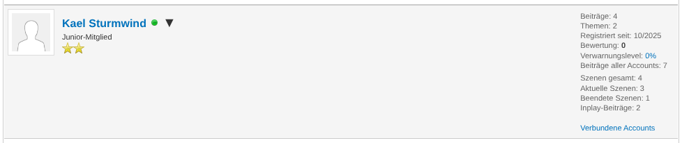
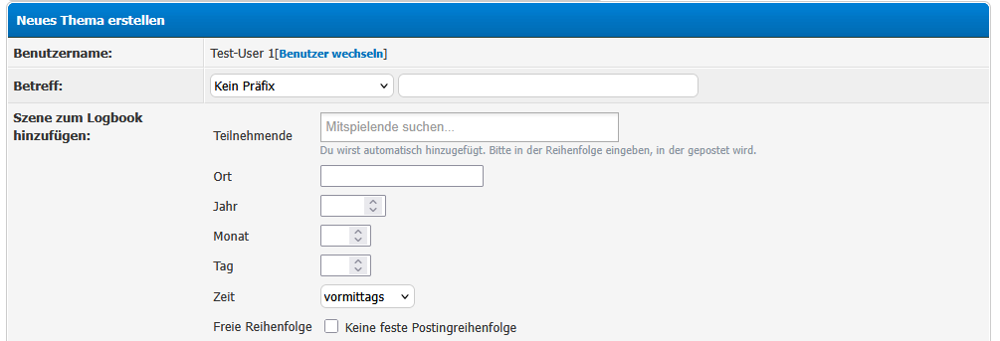
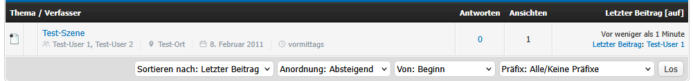
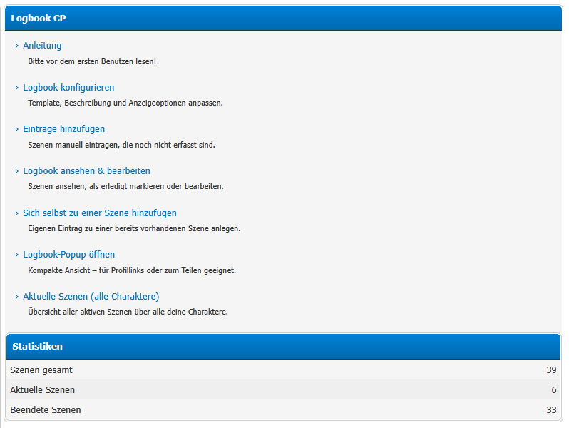
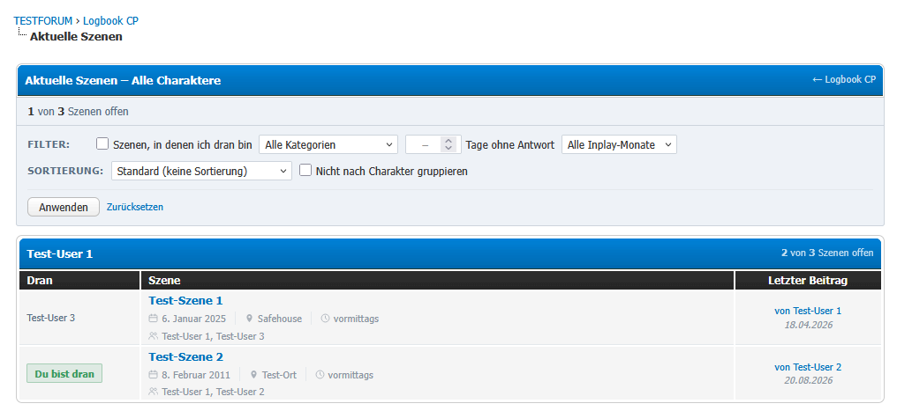
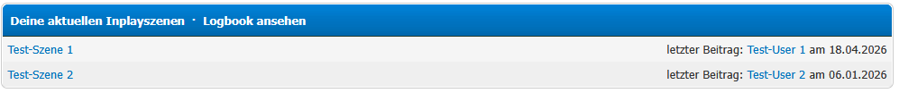
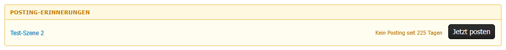
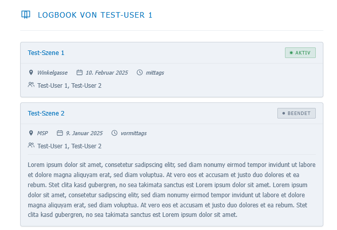

# Logbook

A MyBB 1.8 plugin that lets RPG forum users manage their in-play scenes in a personal logbook.

## Description

When a user creates a new thread in an in-play forum, they fill in scene metadata (location, date, time, participants). The scene is automatically recorded in every participant's logbook. Users can view their logbook, edit scenes, mark scenes as finished, and share a popup view with others.

## Requirements

- MyBB 1.8.x
- PHP 7.4 or higher (compatible with PHP 8.x)

### Optional Plugins

| Plugin | Purpose |
|--------|---------|
| [EnhancedAccountSwitcher](https://github.com/jnschrag/EnhancedAccountSwitcher) | Links character accounts together; enables multi-character scene overview and reminders |
| [MyAlerts](https://github.com/MyBBStuff/MyAlerts) | Sends in-forum notifications when a user is added to a scene |

All optional features are automatically disabled if the respective plugin is not installed.

### Custom Database Tables

No custom tables are required. The archive forum is configured through the **Archive Forum**
plugin setting. For backward compatibility, if a custom `mybb_config` table with a
`name`/`wert` structure exists and contains an `inplay_archive` entry, it is used as a
fallback when the setting is empty. The `mybb_users.as_uid` column is provided by
EnhancedAccountSwitcher and does **not** need to be added manually.

## Installation

1. Upload all files to your MyBB root directory, preserving the folder structure.
2. Go to **ACP → Configuration → Plugins** and click **Install & Activate** next to **Logbook**.
3. Go to **ACP → Configuration → Settings → Logbook** and configure the plugin.

## Theme Integration

On activation the plugin injects its display variables into the standard MyBB
templates automatically, so no manual template editing is needed on stock themes:

| Template | Variable | Shows |
|----------|----------|-------|
| `showthread` | `{$logbook_scene_info}` | Scene info box above the posts in the thread view |
| `forumdisplay_thread` | `{$thread['logbook_meta']}` | Scene meta strip (participants, location, date, time) in the thread listing |
| `header` | `{$logbook_header_link}` | Logbook link in the header navigation |
| `newthread` | `{$logbook_entry_add}` | Scene form on the new-thread page |
| `index` | `{$logbookAccept}` | Reminder bar and scenes widget on the forum index |
| `postbit`, `postbit_classic` | `{$post['logbook_stats']}` | Scene statistics in the author column of every post |
| `member_profile` | `{$logbook_profile_stats}` | Scene statistics block on the member profile |

**Important notes:**

- The injection runs against the templates that exist **at activation time**. If you
  switch to, or import, a theme with its own customised templates **after** activating
  the plugin, deactivate and reactivate **Logbook** once so the new templates receive
  the variables.
- If a heavily customised template does not contain the standard anchor, the variable
  is not injected. In that case add it by hand in **ACP → Templates & Style → your
  template set**: place `{$logbook_scene_info}` above `{$posts}` in `showthread`, and
  `{$thread['logbook_meta']}` next to `{$thread['profilelink']}` (the author link) in
  `forumdisplay_thread`. For the statistics blocks, place `{$post['logbook_stats']}`
  after `{$post['user_details']}` in `postbit`/`postbit_classic`, and
  `{$logbook_profile_stats}` before `{$signature}` in `member_profile`.

## Configuration

### Admin Settings (ACP → Configuration → Settings → Logbook)

| Setting | Description |
|---------|-------------|
| **In-Play Forums** | Multi-select of forums treated as in-play forums. The scene form only appears when creating a thread in one of these forums. |
| **Allowed User Groups** | Multi-select of user groups that may use the logbook. Select none to allow all groups. |
| **Posting Reminder (Days)** | Global default: show a reminder on the forum index when the user has not posted in a scene for this many days. 0 = disabled. Can be overridden per character and per scene. |
| **Archive Forum** | Forum that finished threads are moved to once every participant has marked the scene as finished. Select none to disable moving. |
| **Postbit Statistics** | Which scene statistics are shown in the author column of every post: total scenes, active scenes, finished scenes, overdue scenes, in-play posts. Select none to disable the postbit block. |
| **Profile Statistics** | Which scene statistics are shown as a block on the member profile (same options as the postbit). Select none to disable the profile block. |

### User Settings (via `logbook.php?action=config`)

| Setting | Description |
|---------|-------------|
| **Template** | Display template for the popup view |
| **Description** | Personal character description shown in the popup |
| **Posting Reminder (Days)** | Per-character override for the reminder threshold. 0 = use the ACP default. |

## Usage

### First Steps After Activation

1. Go to **ACP → Configuration → Settings → Logbook** and select the in-play forums.
2. Optionally restrict access to specific user groups and configure the posting reminder threshold.

### Core Workflow

**Creating a scene automatically:**
1. Create a new thread in an in-play forum.
2. Fill in the scene form that appears below the post editor: location, in-game year/month/day, time of day, scene type.
3. Add participants from the dropdown. Each participant is automatically added to the scene.
4. Submit the thread. All listed participants receive a MyAlerts notification (if MyAlerts is installed).

**Managing your logbook:**
- `logbook.php` — Logbook CP overview with scene statistics
- `logbook.php?action=usercp_view` — View, edit, and delete your scenes
- Click the toggle button next to a scene to mark it as finished (moves thread to archive if configured)
- Click the pencil icon to edit scene metadata, your personal notes, and the scene's participants

**Viewing all active scenes:**
- `logbook.php?action=my_scenes` — Overview of all active scenes across all linked characters (requires EnhancedAccountSwitcher for multi-character view)
- Filter by scene category, days since last post, in-game month, or open scenes only (scenes where it is your turn)
- Sort by last post date or in-game date

**Viewing logbooks:**
- `logbook.php?action=popup_view&userId=X` — View any user's logbook as a popup
- Share this link with others to show your complete logbook

### Manually Adding a Scene

If a scene was not added automatically:
1. Go to `logbook.php?action=scene_add`
2. Select the scene type. For Normal and AU scenes, enter the **Thread ID** (visible in the thread URL: `?tid=X`). Unplayed and Planned scenes do not require a thread.
3. Fill in all scene details and add participants.

### Adding Yourself to an Existing Scene

1. Go to `logbook.php?action=add_participant`
2. Enter the **Thread ID** of the scene (visible in the thread URL: `?tid=X`) and optionally your personal notes.

### Removing a Participant from a Scene

If the wrong account was added to a scene — for example, a scene was opened with the wrong character or with a main account by mistake — you can remove that participant again:

1. Open the scene for editing (pencil icon in `logbook.php?action=usercp_view`).
2. Scroll to the **Participants** table below the edit form.
3. Click **Remove** next to the account to take out of the scene.

You can only remove your own account and accounts linked to yours via EnhancedAccountSwitcher (your own character family). Participants belonging to other users cannot be removed. Removing a participant deletes their entry for the scene, so the scene disappears from their logbook and they are no longer shown in the "who is next?" turn order.

### Scene Types

| Type | Description |
|------|-------------|
| **Normal** | A standard in-play scene with a thread |
| **AU** | Alternate-universe scene with a thread |
| **Unplayed** | Scene that has been described but not written out (no thread required) |
| **Planned** | Scene that is planned for the future (no thread required) |

Unplayed and Planned scenes can be set to private (visible only to you) or public.

### Posting Reminder

The plugin shows a reminder bar on the forum index when:
- The scene is active and not in free-order mode
- It is your turn to post (determined by post history in the thread)
- The time since the last post in the thread meets the configured threshold

The reminder threshold follows a priority cascade: per-scene setting → per-character setting → ACP default.

To configure a per-scene override, edit the scene and set the **Posting Reminder** field. Set it to 0 to fall back to the character or ACP default.

### Scene Statistics in Postbit and Profile

In addition to the statistics on the logbook page, the plugin can show a small scene-statistics block in the author column of every post and on the member profile.

- Configure them under **ACP → Configuration → Settings → Logbook**: **Postbit Statistics** controls what appears in each post, **Profile Statistics** what appears on the profile. Each is a set of checkboxes — tick the values you want and leave the rest unticked (tick none to hide the block entirely).
- Available values: **Total scenes**, **Active scenes**, **Finished scenes**, **Overdue scenes** and **In-play posts**. "In-play posts" counts the member's visible posts in the forums selected under **In-Play Forums**.
- The blocks only appear for members whose group is permitted by the **Allowed User Groups** setting, so non-roleplay groups (e.g. a bot or system account) stay clean.

## Screenshots

**Scene form when creating a new thread in an in-play forum**

**Scene info box shown inside the thread**

**Logbook CP overview with scene statistics**

**Overview of all active scenes across linked characters**

**Scenes widget on the forum index**

**Posting reminder on the forum index**

**Logbook popup view**

## Uninstallation

1. Go to **ACP → Configuration → Plugins** and deactivate **Logbook**.
2. Click **Uninstall** to remove the database tables.
3. Delete `logbook.php` from your MyBB root directory manually.

> **Warning:** Uninstalling removes all logbook data permanently.

## Changelog

See [CHANGELOG.md](CHANGELOG.md) for the full version history.
